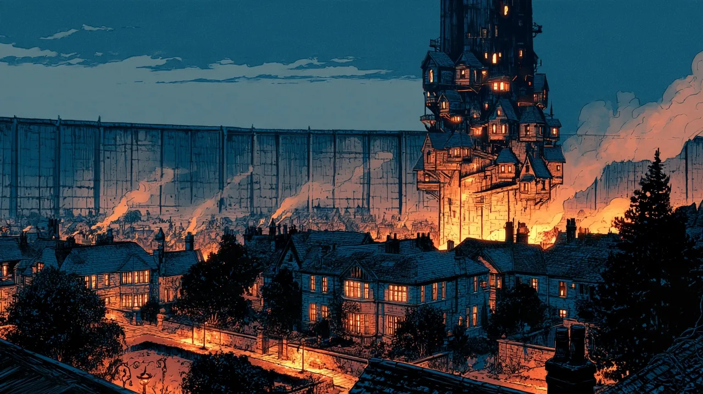

# The College of Arcanographers

As close as the city has to a place of higher learning, the Arcanographers deal
with the science of magic and essence - researching its effects and its uses
beyond a pure power source. They generally lack respect from the other guilds due
to the theoretical nature of their studies, and are largely uninvolved in
politics, buried in their work instead. They hold a seat on [[The City Council]].

The College admits students ad hoc, with no fixed terms. When a seat frees up, a
professor interviews a candidate to fill it.

- **Dean:** [[Dean Edmund Whitaker]]

## The Spire

The College's Spire has a tall, thin core - and remarkably little attached to it. Its wings and blocks hang in the air a short way off the central tower, held there by **enchantment**, joined to it and to one another by a great many narrow bridges. Threaded together that way, the whole assembly reads from the street as one thick tower, when in truth it is a dozen separate buildings arranged around a shaft of stone.

Crossing between them is not for everyone: the bridges are thin, the gaps beneath them are open, and the block you are walking toward is floating. Several of the blocks reach higher than the core itself, so from a distance the College's outline is broken and toothed - a crenellated round tower rather than a spire. At night the windows do not all glow the same colour; each shade is subtle on its own, but together they give the whole building a faint **multicoloured aura**.

## Inside the Spire

A secretary keeps the front door, and students pass her without question, since they
live in the building. The **dormitories** are low in the spire and the **professors'
offices** higher up. Enchanted lifts, circular podiums, run up and down a shaft in the
centre of the spire, and corridors cross at it on each floor. There are bridges across
the gaps and staircases that move, some of it to impress guests and some simply to
make life easier for the people who work there. Professors work late in their offices,
and nobody thinks anything of a student on an errand in the corridors at night.

## Formation

The **last** of the guilds to be formally founded and recognised, for the simple reason that nobody could call it essential. For years it was not a guild at all - only a loose scattering of scholars and wizards who had come to Parvo for refuge like everyone else, and who shared ideas informally among themselves because there was nowhere else to take them. It became an institution when **Edmund Whitaker** proposed founding an official college, and he has led it ever since.

Like every Council guild, the College is housed in its own [[The Spires|Spire]], out in [[The Outlines|the Outlines]], and keeps **dormitories** for its students within it.

## Episode 8

On the night of Tide 05, [[Calder Flynn|Calder]] broke into
[[Professor Benjamin Buckman|Professor Buckman]]'s office, at the end of a corridor
high in the spire. He sensed a ward on the door, picked the lock, and went in
invisible. The office was half empty. He took [[The Secondment Agreement]] and
[[The Blueprints]], and left a wrapped package and a College file.

He knocked a ladder over, and the College secretary came up in the lift with her keys.
She sensed the magic on him as he slipped past her, shouted *"Intruder! Stop!"* and
tried to hold him with a spell, which he shook off. He stepped up the lift shaft to
the floor above and stood there with his notebook open. She believed him, asked
whether he had seen where they went, and sent him to his room: *"I'm locking the spire
down until we find out what's happened here."* By morning the students had gossip, and
no leads or suspects that he heard of.
