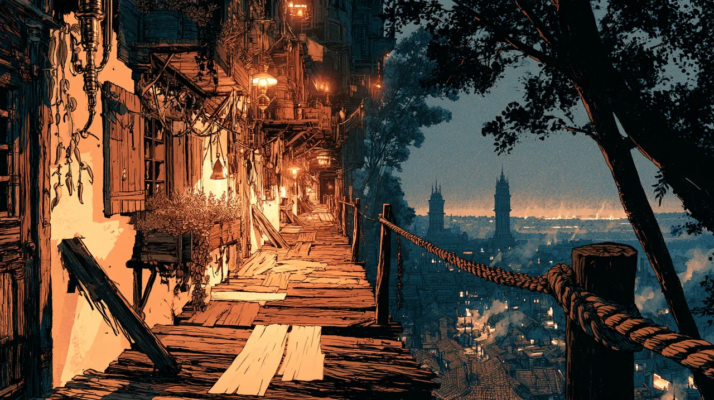

# The Stacks

The Stacks are the residential districts built up the side of the main chimney
stack at the centre of [[Parvo]]. The concrete of the chimney stays warm at all
hours, giving residences free heating through proximity. Houses, shops, and
community buildings are built on top of each other, with spare space used as
balconies, gardens, and thoroughfares.

Although one might expect a messy arrangement, the engineering prowess of the
city has led to a relatively organized, well-constructed section of buildings,
with walkways, ladders, and spiralling ramps connecting different tiers. Pulley
systems and chutes carry goods up and down, and life continues vertically just as
it does in the regular groundside districts below.

While travelling all the way up to the highest buildings can be a tiresome feat,
some residents have everything they need in the Stacks and rarely travel down,
creating insular communities high above the bustle. This close to the constantly
operating essence engine, the air is humid and thick with a misty runoff - not
quite pollutant, not quite pure. For this reason, and the awkwardness of vertical
navigation, the houses here are less in demand and tend to be inhabited by the
poorer parts of the city and the waves of refugees who arrived after
[[The Theocide]].

It was here, among the community he grew up in, that [[Theodore Blackwood]] kept his home.

## Episode 8

Midway up, the houses are built into the sides of one another in rows, each with
another house on top of it and a wooden catwalk round it. In the rain, people cross
from balcony to balcony to keep dry. A single person might have one room built into
the side of a stack, with a stovepipe and a skylight, and beyond the skylight the
rooftops are smoke and steam.
